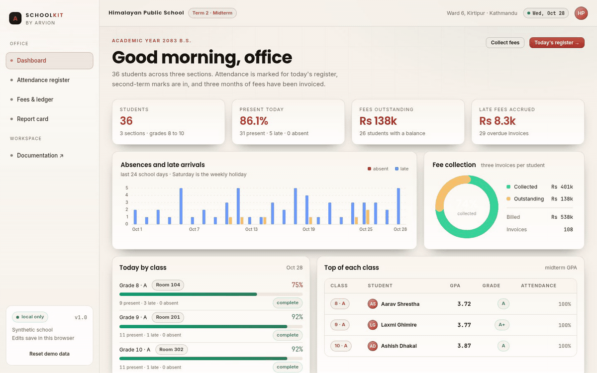
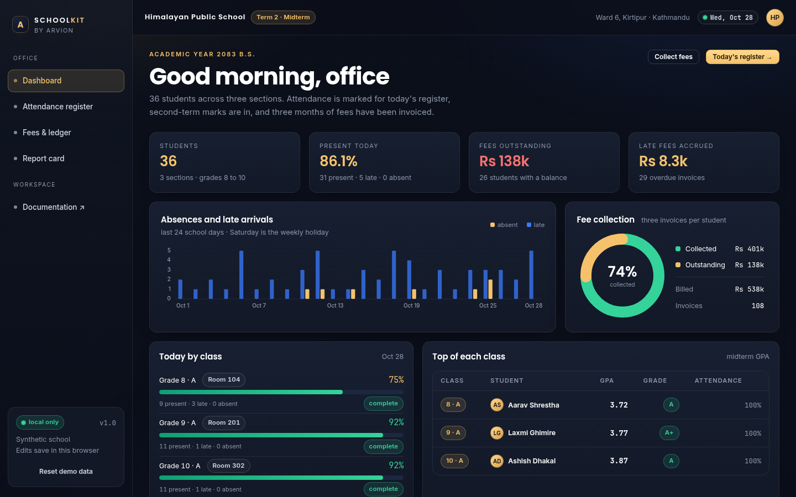

<div align="center">

</div>

<sub>Recorded from the live demo, <a href="docs/demo.mp4">MP4</a> · <a href="docs/screenshot.png">static frame</a></sub>

# SchoolKit

A small school office in a browser tab: a daily attendance register, monthly fee
invoices with partial payments and late fees, exam marks with a credit-weighted
GPA, class ranking, and a report card that prints straight from the page.

[**Open the live demo**](https://arvion-technology.github.io/labs/demos/schoolkit/demo/) · [CI](https://github.com/arvion-technology/schoolkit/actions/workflows/ci.yml) · [MIT](LICENSE)

---

The demo school is invented but the arithmetic is not: 36 students in three
sections, 24 school days of attendance, 252 midterm marks and 108 invoices, all
generated from one seed. Every number you see, the 74% collection rate, the GPA
on a report card, the rank in the section, comes from the modules in `src/`,
which are the modules the tests exercise. Nothing is typed into the HTML.

Two decisions shape the rest of the code. Grades are credit-weighted, because a
four-credit Mathematics fail is not the same as a two-credit one. Late fees are
computed from the outstanding balance when you look, not stored on the invoice,
because a balance changes the moment a payment arrives.

## What it does

- **Dashboard**: present today, fees outstanding, late fees accrued, an
  absences-and-late-arrivals chart, attendance by section and the top student in
  each section.
- **Attendance register**: pick a section and a school day, mark P/L/A/E per
  student. Every mark is kept in `localStorage`, and the per-student term
  percentage updates as you go.
- **Fees and ledger**: billed, collected, outstanding and late fees; a student
  ledger sorted by payable amount; a payment modal that allocates a lump sum to
  the oldest invoice first and reports any excess.
- **Report card**: marks, grade, GPA and rank per subject, attendance, result,
  and a print button. Rank is competition ranking inside the section (1, 2, 2, 4).
- **Reset**: rebuilds the school from the seed, discarding local edits.

## Screenshots

| Dashboard | Report card |
| --- | --- |
|  |  |

## Architecture

```
 demo/index.html ──► demo/app.js ──┬──► src/academics.js   grades, GPA, rank, attendance
                                   ├──► src/fees.js        invoices, late fees, allocation
                                   └──► src/data.js        seeded school, scale, rule, calendar

 arvion.css / arvion.js  shell, tables, charts (shared, untouched)
 test/                   academics.test.js + fees.test.js, frozen clock
```

The demo layer is deliberately dumb. It renders rows, wires clicks and calls one
of two pure modules. When a payment is recorded, the demo does not adjust a
number by hand, it hands the invoice list to `allocatePayment` and re-renders
from the result.

The data shapes are small:

```js
// attendance record
{ studentId: "S-1001", date: 1793059200000, status: "present" } // present|late|absent|excused
// fee invoice
{
  id: "INV-4107", studentId: "S-1001", month: "September 2026",
  issuedAt: 1788220800000, dueAt: 1791244800000,
  items: [{ label: "Monthly tuition", amount: 4500 }],
  subtotal: 4500, discount: 0, total: 4500,
  payments: [{ amount: 2250, paidAt: 1790976000000, method: "eSewa" }]
}
```

## How grades and GPA are computed

Each subject carries a credit weight: Nepali, English, Mathematics and Science
are four credits; Social Studies and Computer Science three; Health and Physical
Education two. A subject mark becomes a percentage, the percentage becomes a
grade on a simplified 4.0 table, and the GPA is the credit-weighted mean:

```
A+  90-100  4.0      B   60-69  2.8      C   40-49  2.0
A   80-89   3.6      C+  50-59  2.4      D   30-39  1.6
B+  70-79   3.2                            NG  below 30, 0.0
```

A student with 80, 60 and 90 in three subjects of 4, 4 and 2 credits gets
`(3.6×4 + 2.8×4 + 4.0×2) / 10 = 3.36`, not the unweighted `3.47`. Below 40% in a
subject is a fail; any fail makes the result a fail and the report card lists the
subject by name.

The rank is competition ranking within the section. Two students tie only when
both GPA and percentage match; they share a rank and the next student skips one.
The report card and the dashboard's "top of each class" call the same
`rankCards`, so they cannot disagree.

## How fees and late fees are computed

An invoice has line items, a discount and a total. Payments are a list; the
balance is always derived:

```js
balance = total - sum(payments)
```

A late fee applies only after the due date, and the first week is a grace period.
After that it is 2% of the *outstanding balance* per full week, capped at 20% of
the invoice total. So an invoice of Rs 4,500 with Rs 2,500 still unpaid, 30 days
past due, accrues `floor(30 / 7) = 4` periods on Rs 2,500, 4 × 2% × 2,500 = Rs
200, which is also exactly the cap for that invoice.

Because the fee depends on today's balance, `invoiceTotals(invoice, { now })` is
the only function that answers "what does this family owe today". Payments are
allocated oldest invoice first by `allocatePayment`, which returns what it
applied and what it could not apply rather than silently keeping the excess.

## Quickstart

```bash
git clone https://github.com/arvion-technology/schoolkit.git
cd schoolkit
npm test          # 26 tests, no dependencies, Node 20+
npm run demo      # http://localhost:4173
```

There is nothing to install. To compute a report card from your own data:

```js
import { reportCard, rankCards } from "./src/academics.js";

const card = reportCard(student, marks);
// { totalMarks, totalFull, percent, gpa, grade, pass, failedSubjects, rows }
const ranked = rankCards(allCards);          // adds `rank` to each card
```

## Tests

```bash
npm test
```

26 cases on `node:test`. The academics suite covers scale thresholds and
clamping, credit-weighted GPA, ignored missing subjects, failed-subject lists,
competition ranking with ties, grade distribution, the attendance definitions,
register completeness, per-student and per-day rollups, immutable status edits
and the Saturday rule. The fees suite covers balances from payment lists, the
grace week, per-week late fees on the outstanding balance, the 20% cap, partial
and over-payments, oldest-first allocation, student outstanding totals,
collection rates, ageing buckets and ledger sorting.

The demo bundle has its own check for broken asset references and placeholder
text:

```bash
node scripts/serve-check.mjs
```

## Limitations

This is a demo, not school software. There is no server, no login and no audit
trail, two clerks editing the same register in different browsers would not see
each other, because the only storage is `localStorage`. Attendance is one status
per student per day (no half-days or subject-wise periods) and Saturday is the
only weekly holiday; festival holidays are not modelled.

The grading scale is a simplified 4.0 table, not the NEB letter-band transcript
used in Nepal, and practical marks, internal assessment and credit transfer are
not implemented. Fees cover one currency, with no waivers or scholarships, no
instalment plans and no PDF receipts. The report card prints through the
browser's own print dialog rather than generating a file.

All names, guardians and marks are synthetic.

## Project layout

```text
schoolkit/
├── demo/
│   ├── index.html      # dashboard, register, ledger, report card
│   ├── app.js          # rendering, register clicks, payment modal
│   ├── styles.css      # register, ledger, printable sheet
│   ├── arvion.css      # shared design system (not edited)
│   └── arvion.js       # shared helpers (not edited)
├── src/
│   ├── data.js         # seeded school, dates, scale and fee rule
│   ├── academics.js    # grades, GPA, ranking, attendance
│   └── fees.js         # invoice totals, late fees, allocation, ageing
├── test/               # 26 node:test cases
├── scripts/            # static server, screenshots, bundle checks
└── .github/workflows/  # CI: tests on Node 20 and 22
```

## Credits

Built by [Arvion Technologies](https://arviontech.net) in Kathmandu, as part of
our open-source [Labs](https://github.com/arvion-technology/labs) series. We build
web platforms and internal tools for clients; a school office is a fair test of
whether a codebase stays readable once the rules get local.

MIT licensed.
